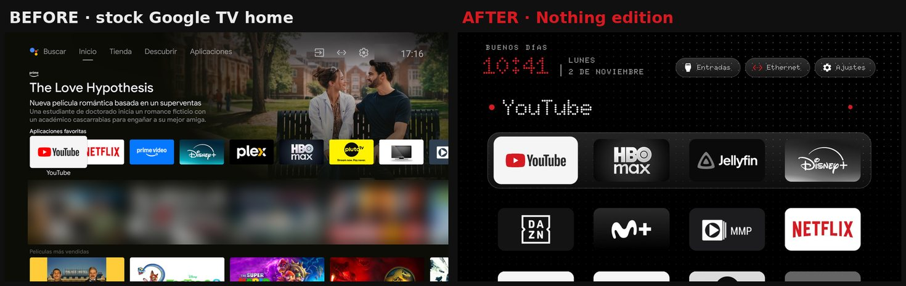
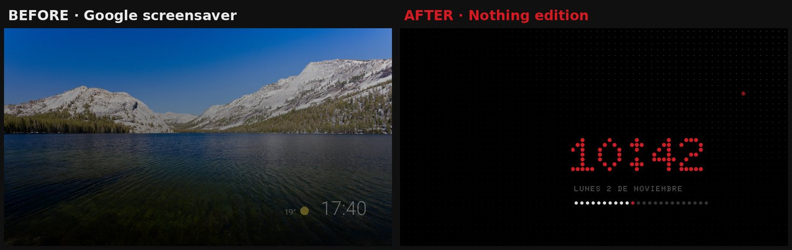

# CleanYourTV · Nothing edition

The [CleanYourTV](https://github.com/Gathin23/cleanyourtv) launcher for Android TV with the look of **Nothing OS**:
dot-matrix font, one red, white lines. No ads, no network.





## What's new

- **Dot-matrix font** ([Doto](https://github.com/oliverlalan/Doto)) for the clock, greeting, date and buttons
- **One red:** the clock, your name in the greeting, a dot beside the focused app, the network icon when online
- **Apps in black and white**, keeping their reds (YouTube, Netflix)
- **Screensaver** with the clock in red dots and the day as 24 dots, the current hour pulsing red
- **Built in:** works from the APK alone, wallpaper included; change it from the TV's own settings

## Install

### With a phone (Android, no computer)

1. **On the TV:** Settings → Device Preferences → About → press OK on **Build** seven times. Back in Device
   Preferences, open **Developer options** and turn on **USB debugging**, plus **Network debugging** or
   **Wireless debugging** if the TV lists it.
2. **On the phone:** install [Tellyscope](https://github.com/man15h/tellyscope) and let it find the TV on your
   Wi-Fi. Accept **Allow debugging?** on the TV (with Wireless debugging, type its pairing code).
3. **Download** `cleanyourtv-nothing.apk` from the [latest release](https://github.com/TheWallHouse/cleanyourtv/releases/latest)
   on the phone. If you like, check its SHA-256 against the one in the release notes.
4. In Tellyscope, **Install apps** → pick the APK. Then open it in the Apps list and choose **Make Home**.
5. **Turn debugging off** on the TV when you're done.

Everything Nothing comes built in, wallpaper included. If CleanYourTV is already on the TV, uninstall it first:
the two apps share a name but not a signature.

### With a computer (Linux, macOS or Windows)

Needs JDK 17 and the Android SDK (platform 34, build-tools 34.0.0), as in [CleanYourTV's README](https://github.com/TheWallHouse/cleanyourtv/blob/nothing/README.md).
Turn on debugging on the TV as in step 1 above, then:

```bash
git clone -b nothing https://github.com/TheWallHouse/cleanyourtv.git && cd cleanyourtv
TV_HOST=192.168.1.50 launcher/build-and-install.sh   # build, install and make it Home
tools/theme.sh themes/nothing                       # optional: the theme, to change it in config.json
```

### Change it from the TV

Hold **OK** on the Settings button → **Launcher settings**: dock, app order, apps per row, wallpaper, clock,
plus **Apps style** (black and white with reds, black and white, or colour) and **Your name** (shown in red after
the greeting). From a computer, the theme's `config.json` can change everything else.

For the clock screensaver: TV Settings → Device Preferences → Screen saver → **Clock**.

## Undo

- **Only this launcher:** Launcher settings → **Remove Nothing edition**. It takes you to the TV's home picker and
  then to this app's Uninstall page. If the TV's own home isn't listed, Tellyscope's **Apps** list (or the TV's
  Settings → Apps → system apps) turns it back on. Nothing else on the TV changes.
- **Everything Tellyscope did:** its **⋮ → Reset TV**.
- **From a computer:** `tools/restore.sh`, as in CleanYourTV.

## More

- [Only the changes](https://github.com/Gathin23/cleanyourtv/compare/main...TheWallHouse:cleanyourtv:nothing) against CleanYourTV
- [NOTHING.md](https://github.com/TheWallHouse/cleanyourtv/blob/nothing/NOTHING.md): every file touched, the screensaver setup, credits
- [CleanYourTV's own README](https://github.com/TheWallHouse/cleanyourtv/blob/nothing/README.md): debloating, supported TVs, tools

Tested on a Vestel Cosmos, Android TV 11. Built on CleanYourTV (MIT) by Gathin23; Doto by Oliver Lalan (OFL).
Not affiliated with Nothing.
