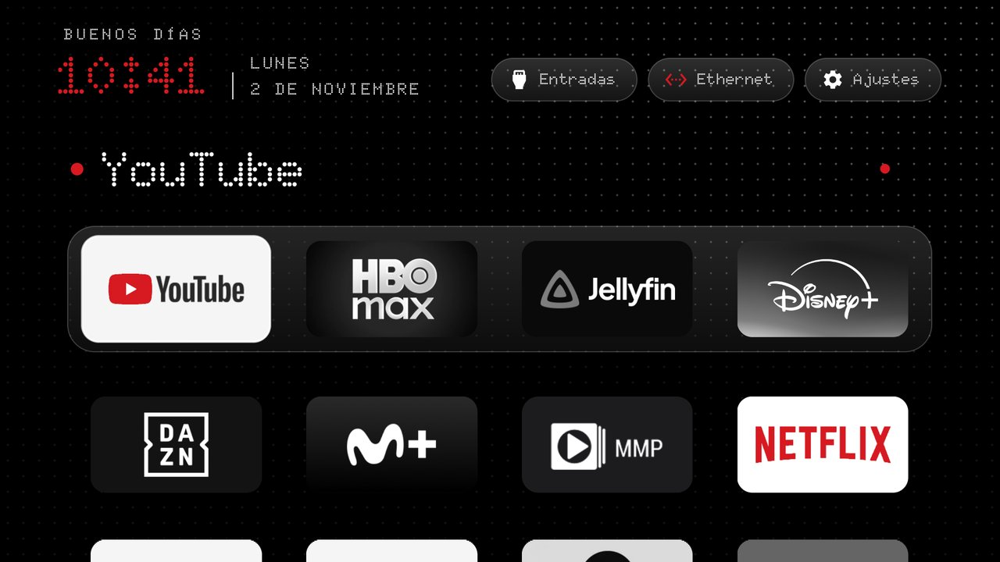
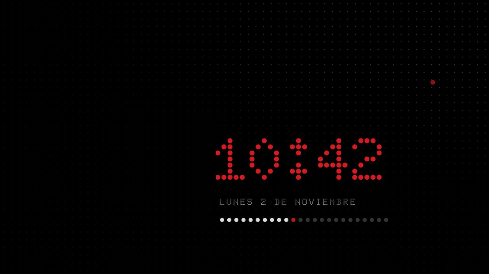

# CleanYourTV · Nothing edition

The [CleanYourTV](https://github.com/Gathin23/cleanyourtv) launcher for Android TV with the look of **Nothing OS**:
dot-matrix font, one red, white lines. No ads, no network.





## What's new

- **Dot-matrix font** ([Doto](https://github.com/oliverlalan/Doto)) for the clock, greeting, date and buttons
- **One red:** the clock, your name in the greeting, a dot beside the focused app, the network icon when online
- **Apps in black and white**, keeping their reds (YouTube, Netflix)
- **Screensaver** with the clock in red dots and the day as 24 dots, the current hour pulsing red
- **`nothing` theme** ready to push

## Install

```bash
git clone -b nothing https://github.com/TheWallHouse/cleanyourtv.git && cd cleanyourtv
TV_HOST=192.168.1.50 launcher/build-and-install.sh   # build, install and make it Home
tools/theme.sh themes/nothing                       # the Nothing look
```

Your name in red: add `"greeting_name": "your name"` to `themes/nothing/config.json` and push the theme again.

## More

- [Only the changes](https://github.com/Gathin23/cleanyourtv/compare/main...TheWallHouse:cleanyourtv:nothing) against CleanYourTV
- [NOTHING.md](https://github.com/TheWallHouse/cleanyourtv/blob/nothing/NOTHING.md): every file touched, the screensaver setup, how to undo, credits
- [CleanYourTV's own README](https://github.com/TheWallHouse/cleanyourtv/blob/nothing/README.md): debloating, supported TVs, tools

Tested on a Vestel Cosmos, Android TV 11. Built on CleanYourTV (MIT) by Gathin23; Doto by Oliver Lalan (OFL).
Not affiliated with Nothing.

---

**En castellano:** el launcher de CleanYourTV con el estilo de Nothing OS: tipografía de puntos, un solo rojo,
apps en blanco y negro y un salvapantallas con la barra del día. Se instala con los mismos tres comandos de
arriba. Todos los detalles están en [NOTHING.md](https://github.com/TheWallHouse/cleanyourtv/blob/nothing/NOTHING.md).
