# WallHouse Launcher

A home screen for Android TV with **seven looks**, each its own: pick the one you like from the TV or from your
phone. No ads, no accounts, no network permission.

| | |
|---|---|
| 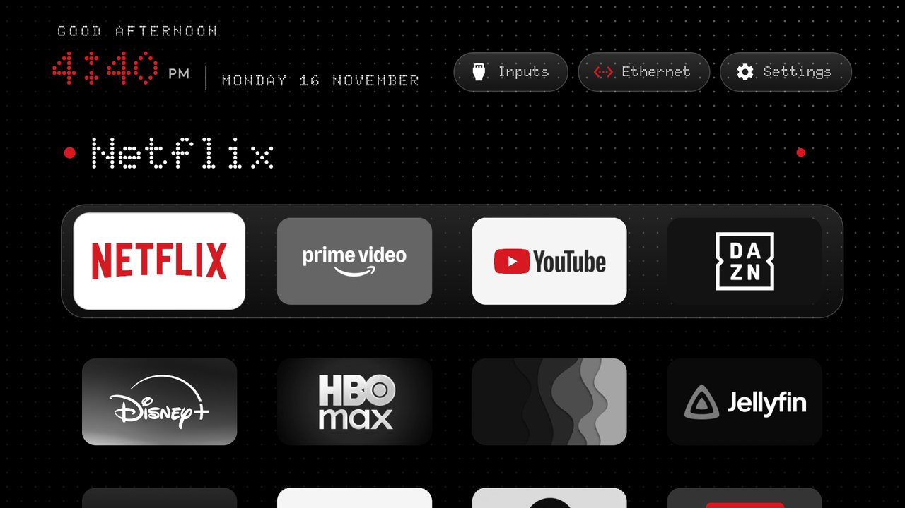 **Nothing:** a dot-matrix font, one red, apps in greyscale with their reds | 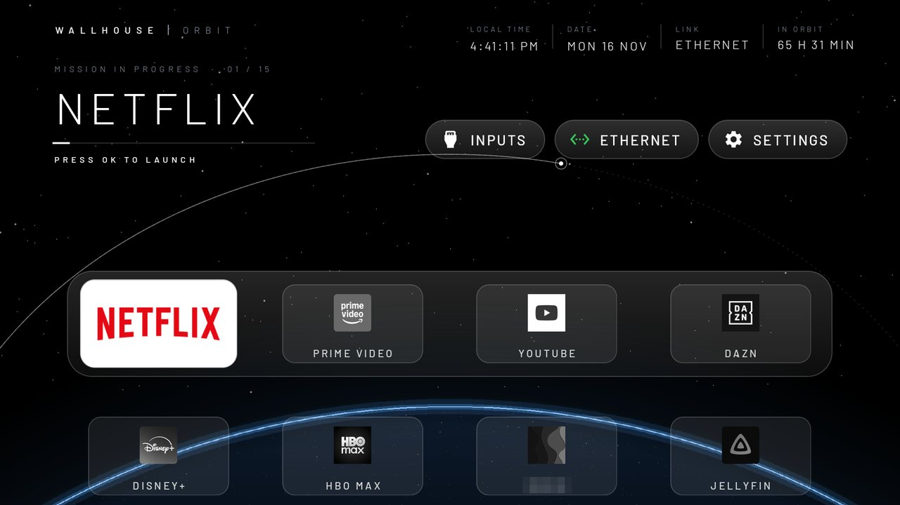 **Orbit:** the Earth seen from orbit, glass tiles, the focused app as the mission in progress |
| 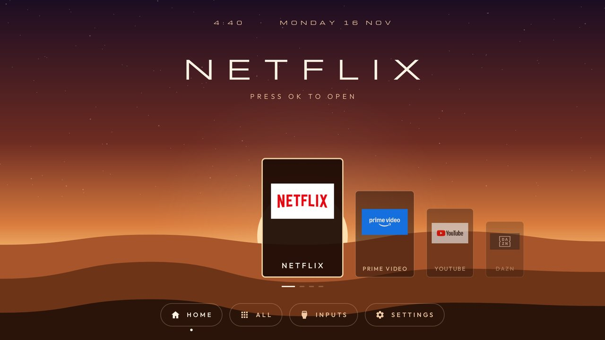 **Dune:** a row of monoliths on the dunes, the app's name across the sky | 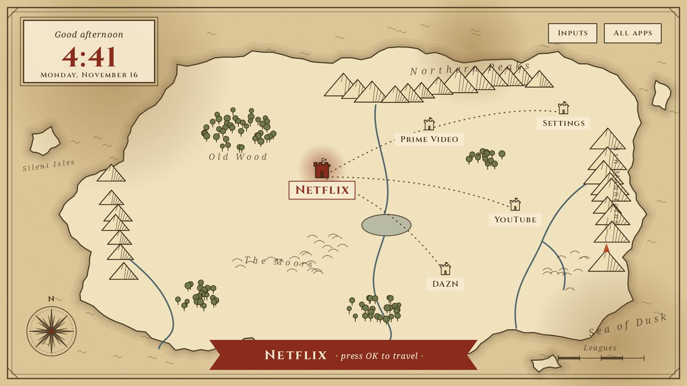 **Map:** a hand-drawn map whose castles are your apps |
| 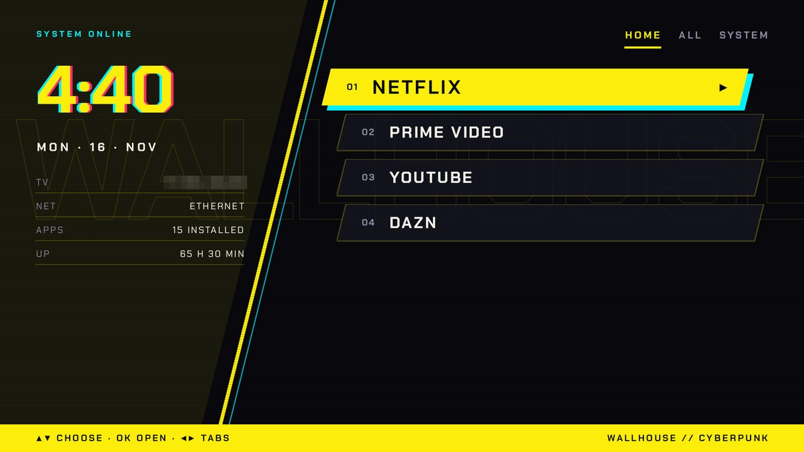 **Cyberpunk:** a game menu of slanted bars, a glitching clock | 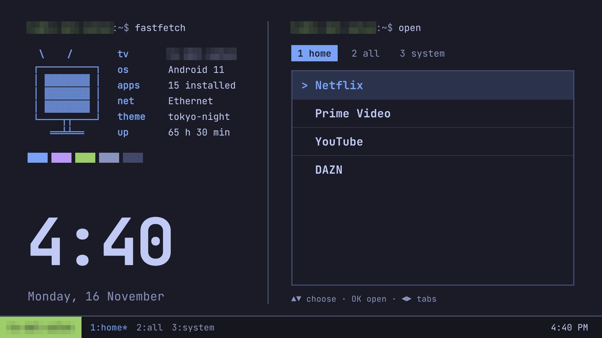 **Terminal · Console:** a terminal session, fastfetch and a list of apps |
| 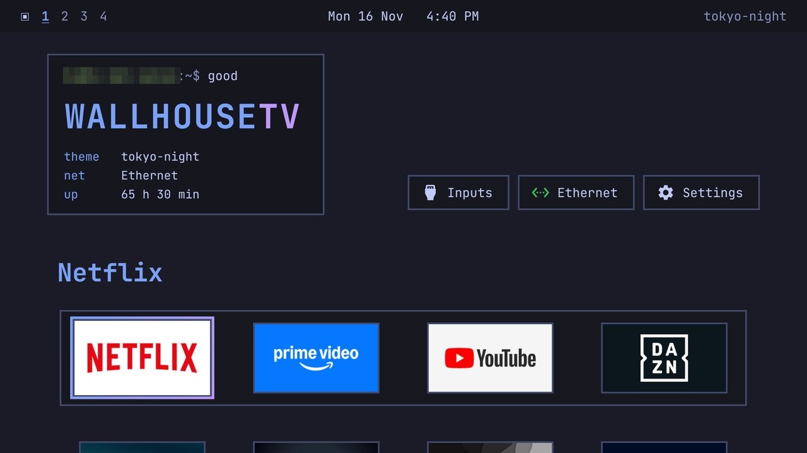 **Terminal · Windows:** the grid as a tiling desktop | Every look and its tones: [LOOKS.md](../LOOKS.md) |

## Install

### With a phone (Android, no computer)

1. **On the TV:** Settings → Device Preferences → About → press OK on **Build** seven times. Back in Device
   Preferences, open **Developer options** and turn on **USB debugging**, plus **Network debugging** or
   **Wireless debugging** if the TV lists it.
2. **On the phone:** install [WallHouse TV](https://github.com/TheWallHouse/wallhouse-tv/releases/latest) and let
   it find the TV on your Wi-Fi. Accept **Allow debugging?** on the TV (with Wireless debugging, type its pairing code).
3. In WallHouse TV, install **WallHouse Launcher** and make it Home. The app downloads it from this repo's
   [latest release](https://github.com/TheWallHouse/wallhouse-launcher/releases/latest) and installs it only if it is signed with this launcher's key.
4. Pick a look and its tone in the app's **Customize** tab; the TV changes at once.
5. **Turn debugging off** on the TV when you're done (WallHouse TV offers it).

### With a computer (Linux, macOS or Windows)

Needs JDK 17 and the Android SDK (platform 34, build-tools 34.0.0). Turn on debugging on the TV as in step 1 above,
then:

```bash
git clone https://github.com/TheWallHouse/wallhouse-launcher.git && cd wallhouse-launcher
TV_HOST=192.168.1.50 launcher/build-and-install.sh   # build, install and make it Home
```

On Windows: `launcher\build-and-install.ps1 -TvHost 192.168.1.50`. Without the SDK, `tools/docker-build.sh`
builds it in a container ([tools/docker-build.md](../tools/docker-build.md)).

The launcher is its own app (`io.github.thewallhouse.nothingtv`), so it installs beside any other launcher; pick
which one is Home.

## Change it from the TV

**Settings**, in every look: a press opens the TV's settings, a long press **Launcher settings**. There:
**Look** and its **Tone** (or **Palette** for the terminal looks), a **Custom message** after the greeting, **Language**,
the clock, animations, and the choices that only make sense in the look you are on (apps per row and the dock in the
looks with a grid of tiles; the apps style and the wallpaper in Nothing).

Every look has its own **screensaver**, in the look's tone, drifting a little every minute against burn-in. Turn it
on in TV Settings → Device Preferences → Screen saver → **Clock**.

| | | |
|---|---|---|
| 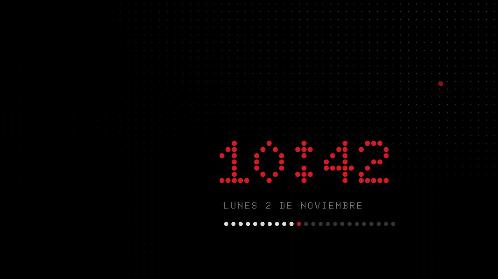 | 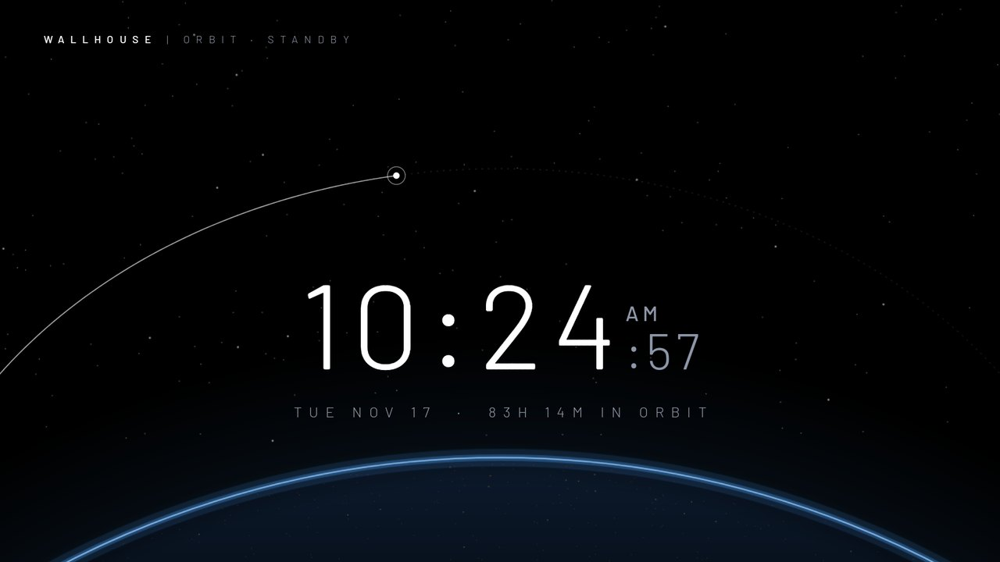 | 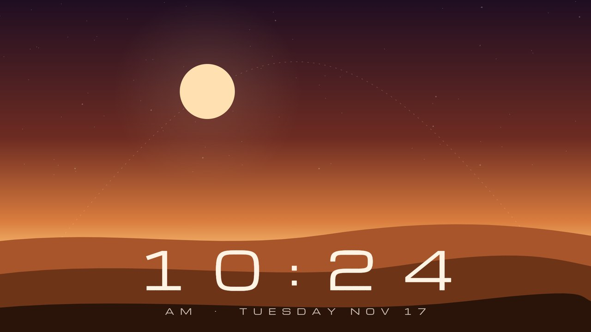 |
| 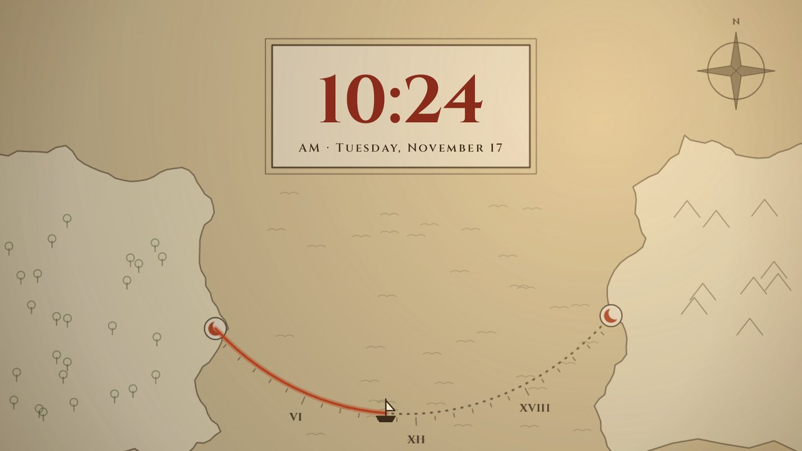 | 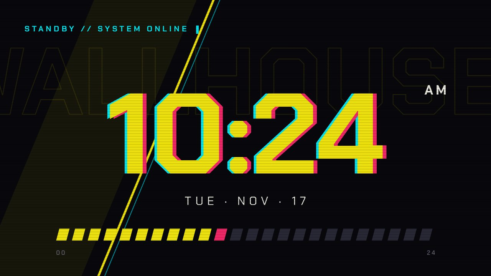 | 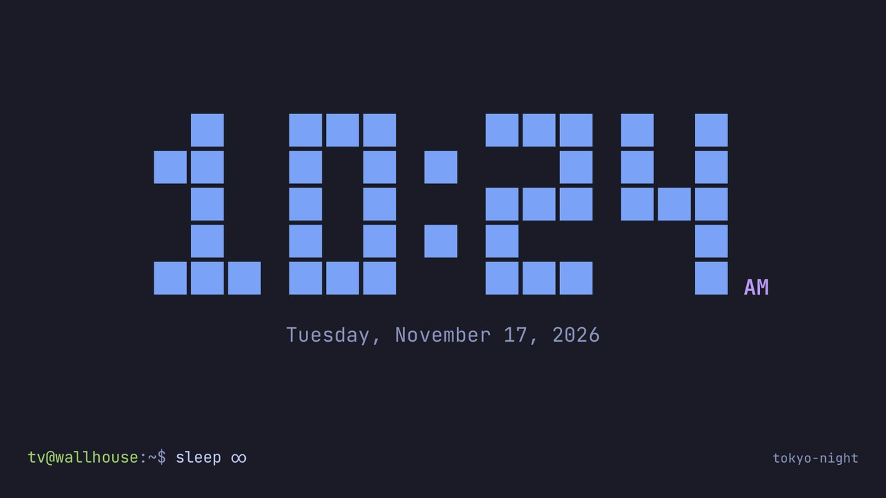 |

## Undo

- **Only this launcher:** Launcher settings → **Remove WallHouse Launcher**. It takes you to the TV's home picker
  and then to this app's Uninstall page. If the TV's own home isn't listed, WallHouse TV's **Apps** list (or the
  TV's Settings → Apps → system apps) turns it back on. Nothing else on the TV changes.
- **Everything WallHouse TV did:** its **⋮ → Reset TV**.
- **From a computer:** `tools/restore.sh`.

## Privacy

No `INTERNET` permission, no analytics, no accounts. Five permissions, as in the launcher it grew from: the network's
and Wi-Fi's state for the network button; location, which Android 10+ requires to read the Wi-Fi network's name
(never asked for on screen, granted by the installer over adb); writing secure settings, only when granted over adb,
to put the remote's key helpers back after the launcher is force-stopped; and Yandex TV OS's input-source permission,
ignored on other TVs. Every look is drawn on the TV: no pictures fetched, no blur, no video.

## The project

- `launcher/`: the launcher. Each look lives in its own folder, `launcher/app/src/main/looks/<look>/`, with its code,
  fonts, pictures, texts and licences; [LOOKS.md](../LOOKS.md) says how they fit together and how to add one.
- `tools/`: what installs it from a computer, and `tools/sync-cleanyourtv.sh`, which brings in CleanYourTV's later
  launcher fixes.

WallHouse Launcher began as a fork of [CleanYourTV](https://github.com/Gathin23/cleanyourtv) by Gathin23 (MIT), whose
launcher it keeps at its core; debloat lists for many TVs, add-ons and themes live there. Tested on a Vestel Cosmos,
Android TV 11.
