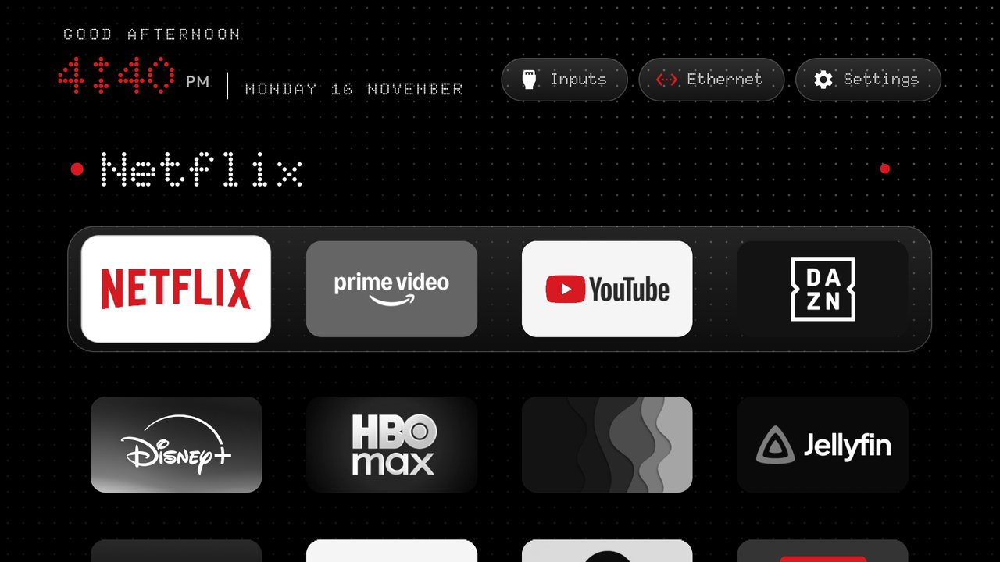
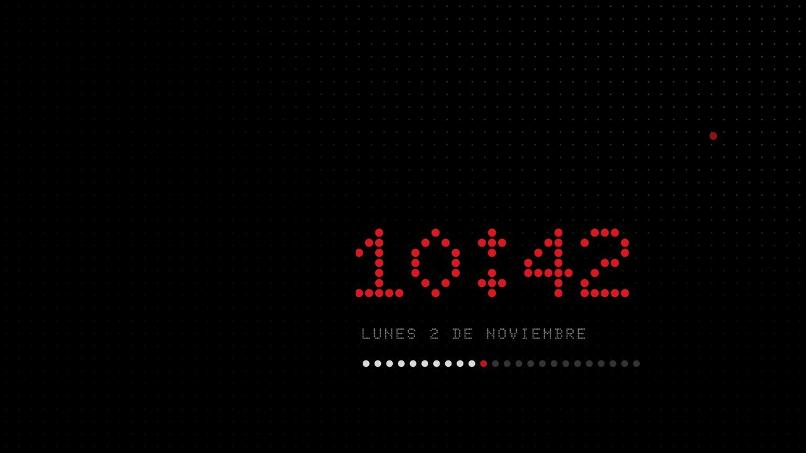
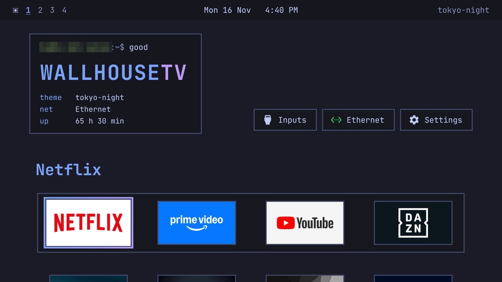
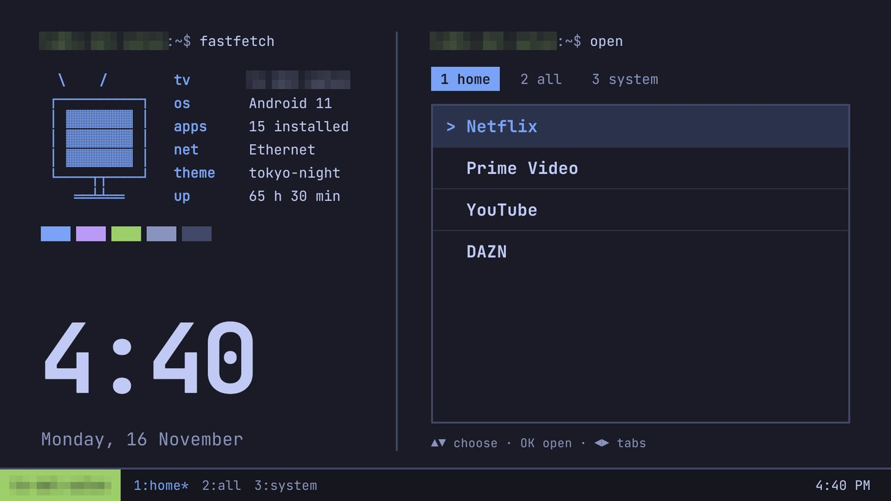
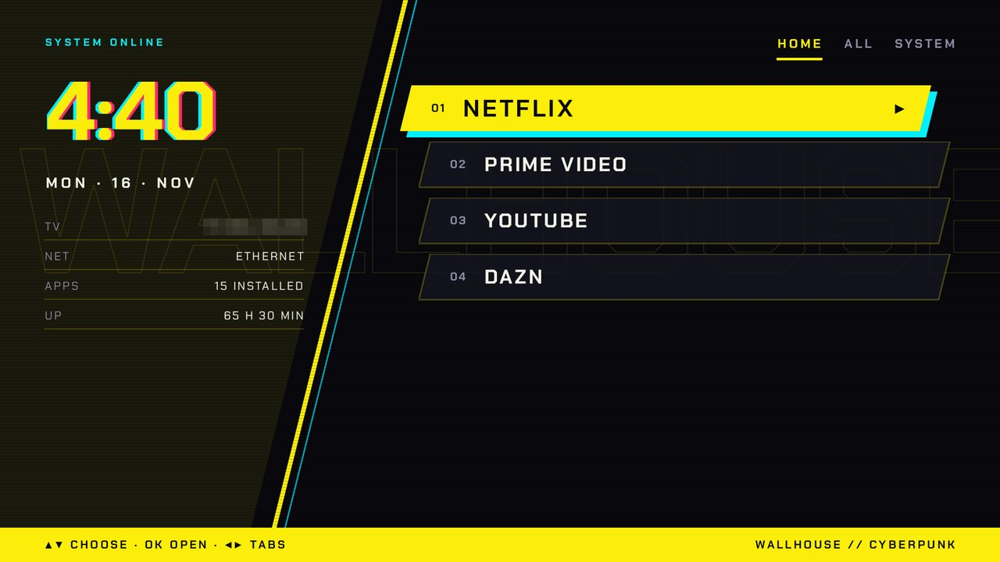
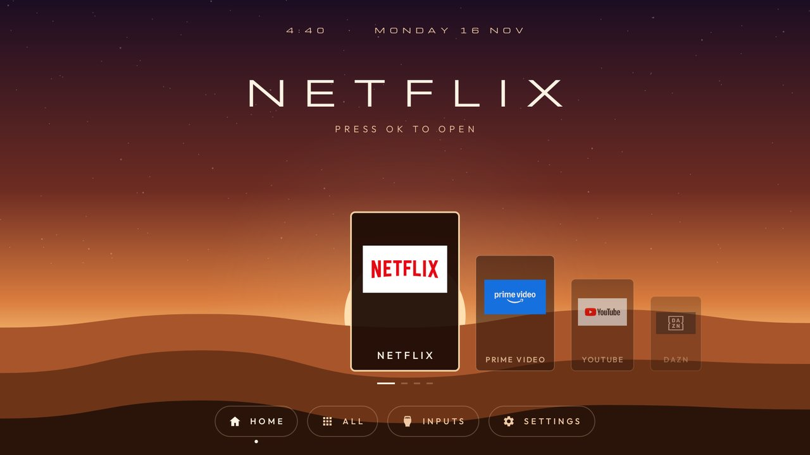
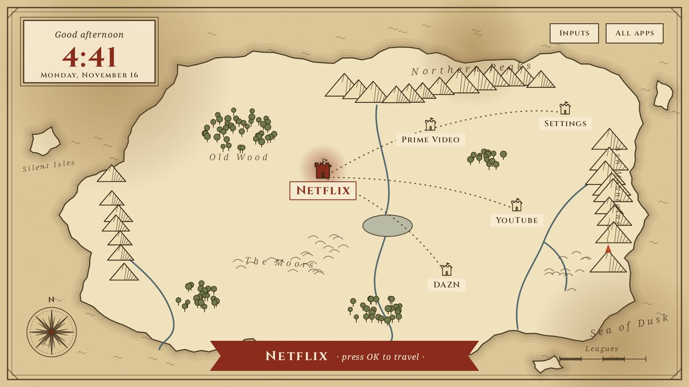
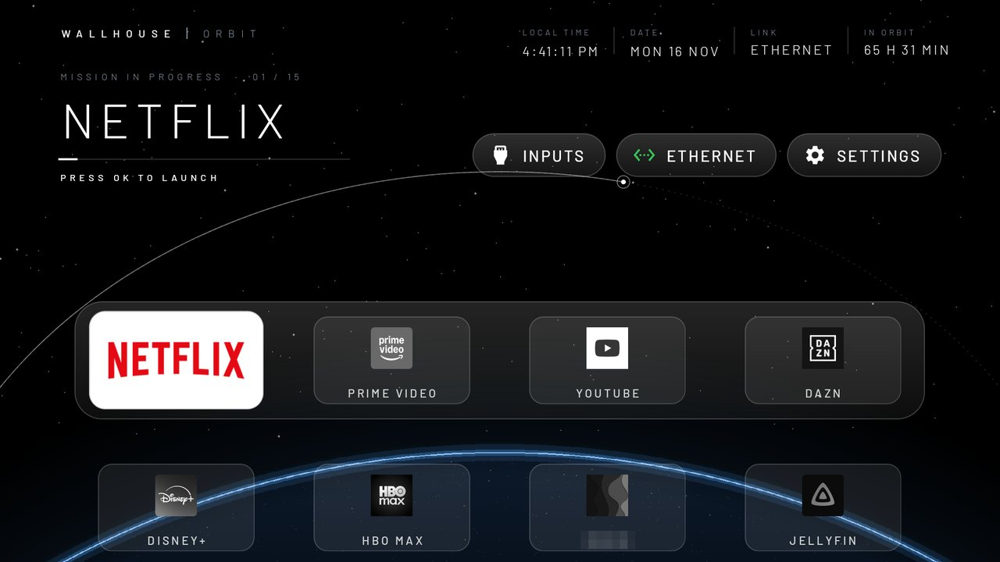

# WallHouse Launcher's looks

The launcher has seven looks. Each is its own: none carries another's font, colours or touches. Pick one in
**Launcher settings → Look** (a long press on Settings), or from the phone with
[WallHouse TV](https://github.com/TheWallHouse/wallhouse-tv) (**Customize**), which writes `aspect` in the launcher's
settings.json. Most have three tones. Everything is drawn on the TV: no pictures fetched, no blur, no video.

In every look, **Settings** works the same: a press opens the TV's settings, a long press the launcher's.
Launcher settings shows only the choices the current look uses.

| Look | Key | Home | Tones | Font |
|---|---|---|---|---|
| [Nothing](#nothing) | `nothing` | The grid of app banners | Apps style: colour, greyscale, greyscale with reds | Doto |
| [Terminal · Windows](#terminal--windows) | `windows` | The grid as a tiling desktop | tokyo-night, catppuccin, gruvbox, nord | JetBrains Mono |
| [Terminal · Console](#terminal--console) | `console` | A terminal session with a list of apps | the same four palettes | JetBrains Mono |
| [Cyberpunk](#cyberpunk) | `cyberpunk` | A game menu of slanted bars | yellow, pink, cyan | Chakra Petch |
| [Dune](#dune) | `dune` | A row of monoliths on the dunes | dusk, noon, night | Michroma |
| [Map](#map) | `legend` | A hand-drawn map, apps as castles | parchment, night, embers | Cinzel |
| [Orbit](#orbit) | `orbit` | The grid over the Earth seen from orbit | night, sunrise, Mars | Barlow |

The looks are moods, not anyone's world: no names, logos or pictures from a film, a game or a book.

## Nothing



Pure black, a dot-matrix font, one red, white lines.

- **Font:** [Doto](https://github.com/oliverlalan/Doto) for the clock, greeting, date, top buttons and the focused
  app's name; a Latin subset with round dots, the colon's crosses moved up one dot to line up with the digits.
- **Red** `#D71921`: the clock, your name after the greeting, a dot beside the focused app's name, and the network
  icon while online (grey without a connection).
- **Apps style** (`nothing_tiles`): banners in greyscale with their reds kept (YouTube and Netflix stay red), plain
  greyscale, or colour.
- **Wallpaper:** a faint dot grid with one red dot, built in, so the APK alone is enough.
- **Screensaver:** the clock in red dots and, under the date, the day as 24 dots: hours gone by in white, the hours
  to come in grey, the current hour pulsing red.



## Terminal · Windows



The grid of apps as a tiling desktop: a bar across the top with numbered rows, the date and time and the palette; a
terminal window in place of the greeting and clock, with the greeting as a prompt, the network and the time on;
square tiles with a thin border; JetBrains Mono throughout. Four well-known terminal palettes.

## Terminal · Console



Home as a terminal session. On the left a fastfetch-style block (the TV, Android, the apps, the network, the palette,
the time on) over a big clock; on the right the apps as a list in three tabs: the dock's, all of them, and the
system's (Inputs and Settings). A tmux-style status line along the bottom.

**Remote:** ▲▼ choose, ◀▶ tabs, OK opens.

## Cyberpunk



A game menu. A status panel on the left with a glitching clock, the date and the TV's details; the apps as slanted,
numbered bars, the focused one filled in neon with a hard shadow; tabs at the top (Home, All, System); a slanted band,
the launcher's name in outline and scanlines behind; a neon help bar along the bottom.

**Remote:** ▲▼ choose, ◀▶ tabs, OK opens.

## Dune



A row of monoliths on a sea of dunes under a low sun (or a white sun at noon, or two moons at night). The focused
app's name stands huge and widely spaced across the sky; the cards grow smaller and fainter towards the edges.

**Remote:** ◀▶ walk the row, OK opens. ▼ goes down to the menu bar, with icons: **Home** and **All** choose which apps
the row shows, **Inputs** shows the TV's inputs as monoliths too, **Settings** as everywhere. ▲ goes back up.

## Map



A made-up hand-drawn map: a ragged coast with islands, mountain ranges and a volcano, forests, hills, rivers and a lake,
region names, a compass rose and a scale in leagues. The dock's apps are castles joined by dotted roads, with one more
for Settings; a cartouche holds the greeting, the clock and the date; a ribbon names the focused place.

**Remote:** the D-pad jumps to the nearest place that way, OK opens. **Inputs** and **All apps**, at the top right,
open on a parchment scroll between wooden rollers: a list of the inputs or a grid of every app. Back rolls it up.

Its key stays `legend`, the name it had while it was being designed, so a TV that chose it keeps its choice.

## Orbit



The grid of apps over the Earth's rim seen from orbit: its glow, the night side's city lights, the stars and a faint
orbit with a satellite. The tiles are dark glass with the app's icon in grey and its name spaced out; the focused
tile's banner lights up in colour. In place of the greeting, the focused app as the "mission in progress", with its
place in the list as a progress line; a telemetry strip shows the local time, the date, the network and the time on.
Inputs open on a mission-control panel.

## How the looks are built

Each look lives in its own folder, with everything it needs:

```
launcher/app/src/main/looks/
├── nothing/     NothingLook, NothingTone, NothingWallpaper, DayDots, Doto, the wallpaper and the red dots
├── terminal/    TerminalSkin, ConsoleHome, TerminalPalette, JetBrains Mono
├── cyberpunk/   CyberpunkHome, CyberpunkTone, Chakra Petch
├── dune/        DuneHome, DuneTone, Michroma
├── map/         MapHome, MapDrawing, MapTone, Cinzel
├── orbit/       OrbitSkin, OrbitTone, Barlow
└── shared/      what more than one look uses: Overlay and the shared texts (look_*, the language, your name…)
```

Inside each: `java/` (the code), `res/` (fonts, pictures, and `values*/strings.xml` with its texts in English, Spanish
and Galician; other languages show them in English) and its fonts' licences. Every folder is in the launcher's
package, `com.gathin.tvhome`, and `launcher/app/build.gradle` adds them to the build.

The base, `launcher/app/src/main/java` and `res`, is the launcher as CleanYourTV ships it: plain, with no look of its
own. A look either draws over the base's grid of tiles (Nothing, Terminal · Windows, Orbit) or covers Home with a view
of its own that lists and opens the same apps, in the same order, with the same dock and hidden apps (Terminal ·
Console, Cyberpunk, Dune, Map).

**To add a look:** give it a folder under `looks/` (and its name in `build.gradle`'s list), a key in `Aspect.ALL`,
its label in Launcher settings, and the line in `MainActivity` that puts it on Home. Start from the base, never from
another look. A tone, if it has some, is its own key in `SettingsFile`, so the phone can set it too.

## Staying up to date with CleanYourTV

This repo keeps only the launcher and what installs it, listed in [`.wallhouse-keep`](.wallhouse-keep). CleanYourTV's
debloat lists, add-ons, themes and docs live in [its own repo](https://github.com/Gathin23/cleanyourtv).

`tools/sync-cleanyourtv.sh` brings in what CleanYourTV has changed since the last time: its launcher fixes arrive,
the rest of its repo stays out. When a change of theirs and one of ours touch the same lines, it stops and names the
files to settle by hand. Then build and test the launcher (in `launcher/`:
`./gradlew testReleaseUnitTest lintRelease assembleRelease`) before a release.

## App ID

`io.github.thewallhouse.nothingtv`, set in `launcher/gradle.properties`. It never passes itself off as CleanYourTV,
and the two can be installed side by side. It stays as it is: a new ID would be a new app, which could not update the
launcher already on a TV. The code keeps CleanYourTV's `com.gathin.tvhome` package, so its screens are named like
`io.github.thewallhouse.nothingtv/com.gathin.tvhome.MainActivity`.

## Credits

- [CleanYourTV](https://github.com/Gathin23/cleanyourtv) by Gathin23 and its contributors, MIT: the launcher at the
  core of this one.
- Fonts, all under the SIL Open Font License 1.1 and subset to Latin; each licence sits in its look's folder:
  [Doto](https://github.com/oliverlalan/Doto) by Oliver Lalan (with the colon adjusted),
  [JetBrains Mono](https://github.com/JetBrains/JetBrainsMono), [Chakra Petch](https://github.com/cadsondemak/Chakra-Petch),
  [Michroma](https://github.com/googlefonts/Michroma-font), [Cinzel](https://github.com/NDISCOVER/Cinzel) and
  [Barlow](https://github.com/jpt/barlow).
- Nothing OS is a trademark of Nothing Technology Limited. This launcher is not affiliated with Nothing; its Nothing
  look only borrows the style.
