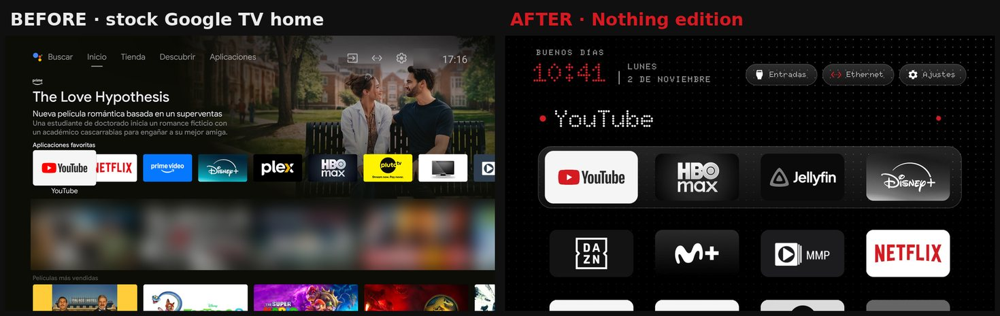
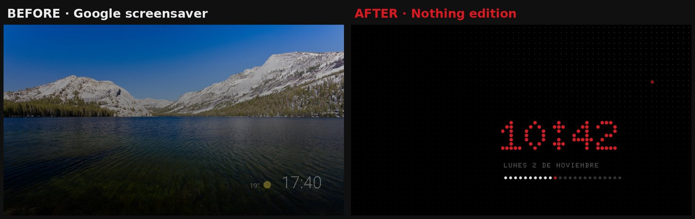

# CleanYourTV · Nothing edition

A fork of [CleanYourTV](https://github.com/Gathin23/cleanyourtv) that gives its launcher the look of
**Nothing OS**: pure black, a dot-matrix font, one red, white lines. Everything else is CleanYourTV as it is:
the same launcher, the same debloat lists and tools, no ads, no network permission.

## What changes

| | Nothing edition |
|---|---|
| **Font** | [Doto](https://github.com/oliverlalan/Doto), a dot-matrix font (OFL), for the clock, greeting, date, top buttons and the focused app's name. Built in as a Latin subset with round dots; the colon's two crosses are moved up one dot so they line up with the digits |
| **Red** | The clock and the name after the greeting (`greeting_name`) in Nothing red `#D71921`. With `wifi_status_color`, the network icon is red while online and grey without a connection |
| **Focus** | A red dot beside the focused app's name, in the grid and on the big name above the dock |
| **Apps** | `nothing_tiles`: app banners in greyscale (`mono`) or greyscale with their reds kept in Nothing red (`mono_red`, the default), so YouTube and Netflix keep their red. Converted once when the tiles load |
| **Screensaver** | The clock screensaver in red dots, and under the date the day as 24 dots: hours gone by in white, the hours to come in grey, the current hour pulsing red |
| **Theme** | [`themes/nothing/`](themes/nothing/): black, a faint dot grid with one red dot, frosted-glass dock, white rim focus, no colour glow, `mono_red` apps |
| **Built in** | The look is the default, so the APK alone is enough: the dot-grid wallpaper ships inside the app, and `config.xml` turns on the glass dock, white rim focus, no colour glow, red network icon and wallpaper behind the screensaver clock |
| **Launcher settings** | **Apps style** and **Your name**, set with the remote; and **Remove Nothing edition**, the two steps back to the TV's own home and this app's Uninstall page |

**Own app ID:** `io.github.thewallhouse.nothingtv` (set in `launcher/gradle.properties`, upstream's `launcherApplicationId`), so it never
passes itself off as CleanYourTV and both can be installed. The code keeps CleanYourTV's `com.gathin.tvhome` namespace,
so its screens are named like `io.github.thewallhouse.nothingtv/com.gathin.tvhome.ClockDream`; the fork's `tools/`
scripts use the new ID.

Not changed: permissions (still no `INTERNET`), `minSdk` 26, the Home guard, the debloat flow. The APK is
about 700 KB, over upstream's 576 KB gate, because of the font and the wallpaper inside it.

## Only the changes

This repository is a full copy of CleanYourTV, because the launcher has to be built whole. What this fork adds
is a handful of commits on top: **[see only the changes](https://github.com/Gathin23/cleanyourtv/compare/main...TheWallHouse:cleanyourtv:nothing)**. Every other file is CleanYourTV as it is.

| File | What it does here |
|---|---|
| `launcher/app/src/main/res/font/doto.ttf` | New: the Doto font, Latin subset, colon aligned |
| `launcher/FONT-LICENSE-DOTO-OFL.txt` | New: the font's licence |
| `launcher/app/src/main/res/values/fonts.xml` | `font_dot`, pointing at Doto |
| `launcher/app/src/main/res/values/styles.xml` | Top buttons in Doto |
| `launcher/app/src/main/res/layout/activity_main.xml` | Clock, greeting, date and app name in Doto; red clock; red dot beside the app name |
| `launcher/app/src/main/res/layout/item_app.xml` | Red dot beside the focused tile's name |
| `launcher/app/src/main/res/layout/dream_clock.xml` | Screensaver in red dots, with the day-dots row |
| `launcher/app/src/main/res/layout-iw/*.xml` | The same two changes for right-to-left languages |
| `launcher/app/src/main/res/drawable/nothing_focus_dot_*.xml` | New: the red focus dot |
| `launcher/app/src/main/res/color/pill_icon_*.xml` | Network icon: red online, grey offline |
| `launcher/app/src/main/java/com/gathin/tvhome/MainActivity.java` | The name after the greeting in red |
| `launcher/app/src/main/java/com/gathin/tvhome/AppAdapter.java` | Tiles go through NothingTone; the name wraps its text so the dot sits beside it |
| `launcher/app/src/main/java/com/gathin/tvhome/NothingTone.java` | New: `nothing_tiles`, greyscale apps with their reds kept; Apps style from Launcher settings wins |
| `launcher/app/src/main/java/com/gathin/tvhome/DayDots.java` | New: the 24 dots of the day under the screensaver clock |
| `launcher/app/src/main/java/com/gathin/tvhome/NothingWallpaper.java`, `res/raw/nothing_wallpaper.jpg` | New: the bundled dot-grid wallpaper, used when no theme put one on the TV |
| `launcher/app/src/main/java/com/gathin/tvhome/Config.java` | The bundled wallpaper as a fallback; Your name from Launcher settings |
| `launcher/app/src/main/res/values/config.xml` | The Nothing look as the default (glass dock, rim focus, no glow, red network icon, screensaver wallpaper) |
| `launcher/app/src/main/java/com/gathin/tvhome/LauncherSettingsActivity.java`, `res/layout/activity_launcher_settings.xml`, `res/values/strings.xml` | Apps style, Your name and Remove Nothing edition in Launcher settings (English only) |
| `themes/nothing/` | New: the theme (config, wallpaper, screenshot) |
| `themes/README.md` | The theme's row and the `nothing_tiles` key |
| `launcher/gradle.properties`, `launcher/build-and-install.*`, `tools/*` | The fork's own app ID, `io.github.thewallhouse.nothingtv` |
| `.github/README.md`, `NOTHING.md`, `docs/nothing/*.jpg` | This documentation (GitHub shows `.github/README.md` on the front page; CleanYourTV's `README.md` is left as it is) |

To bring in what CleanYourTV adds later: `git fetch upstream && git merge upstream/main` on the `nothing` branch.

## Install and undo

With a phone or a computer, and how to undo it: see the [front page](https://github.com/TheWallHouse/cleanyourtv#install).

## Tested on

Vestel Cosmos (MediaTek), Android TV 11, 1.3 GB RAM. The Hebrew (right-to-left) layouts carry the same changes
but were only built, not seen on a TV.

## Credits

- [CleanYourTV](https://github.com/Gathin23/cleanyourtv) by Gathin23 and its contributors, MIT.
- [Doto](https://github.com/oliverlalan/Doto) by Oliver Lalan, SIL Open Font License 1.1
  ([`launcher/FONT-LICENSE-DOTO-OFL.txt`](launcher/FONT-LICENSE-DOTO-OFL.txt)). Subset and with the colon
  adjusted; the OFL allows it and the font keeps its licence.
- Nothing OS is a trademark of Nothing Technology Limited. This fork is not affiliated with Nothing; it only
  borrows the style.
